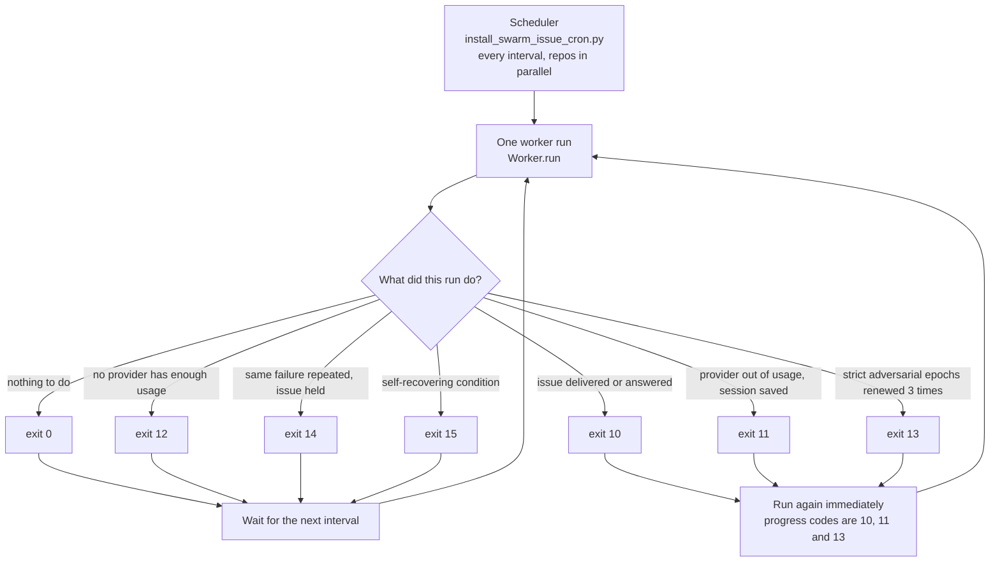
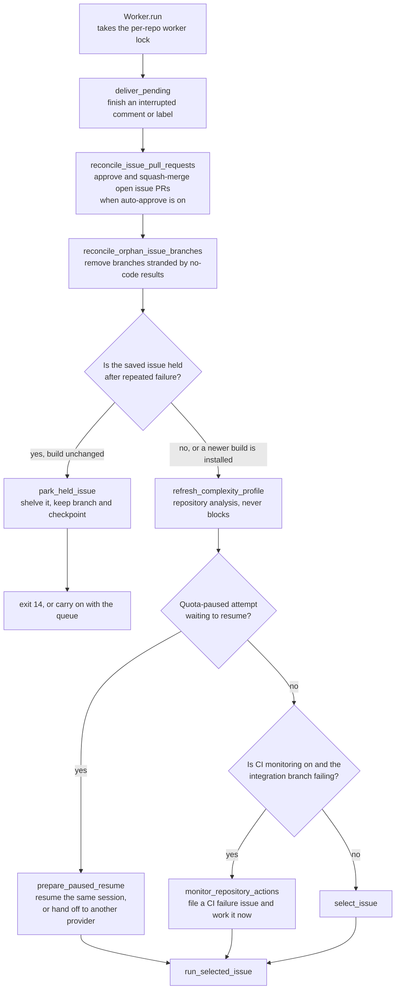
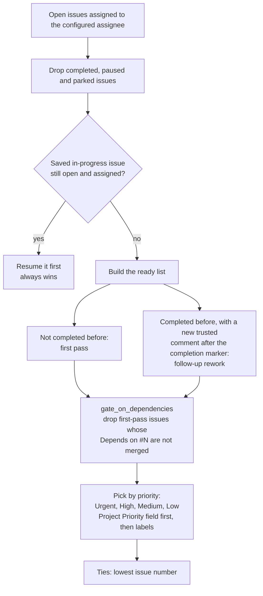
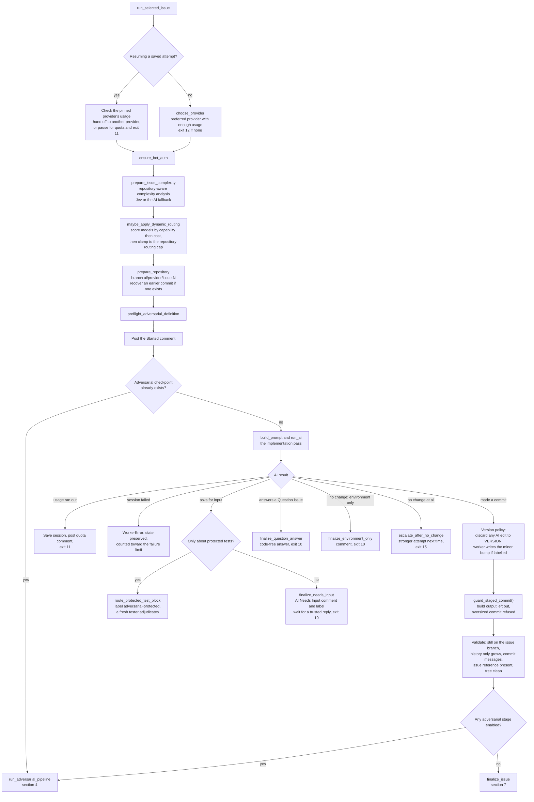
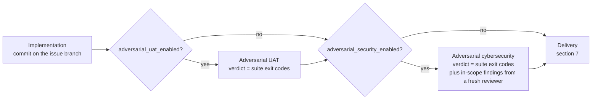
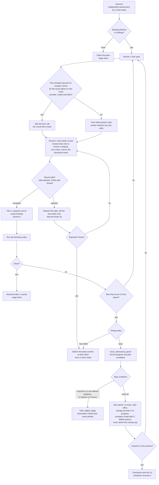
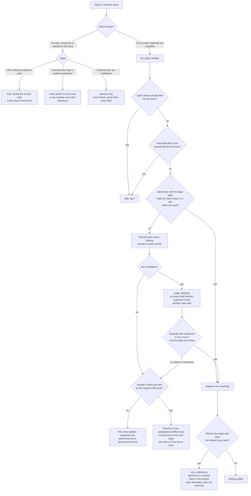
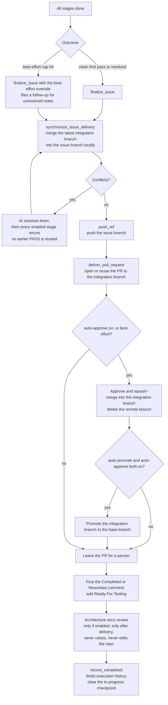
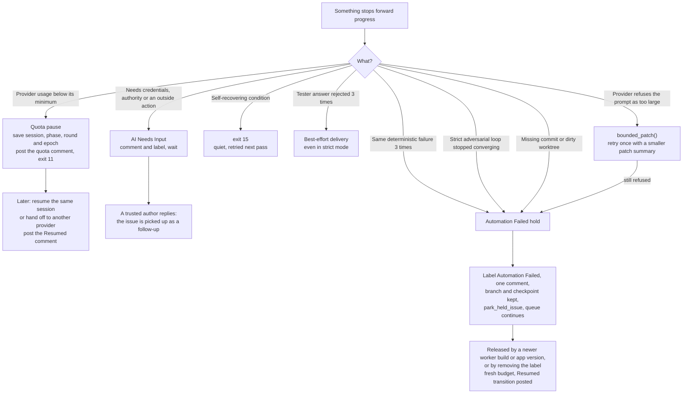

# Issue worker flow

How `issue_worker/` picks up an issue, works it, lets the adversarial reviewers
attack the result, and delivers it. This is the reference for the whole flow;
the diagrams are [Mermaid](https://mermaid.js.org/). They render on GitHub, and `docs/worker-flow.html` is the same content as a standalone visual page.

> **Keep this file in step with the code.** Any change to the flow, a limit, an
> exit code, a label, a comment or a state file must update the matching diagram
> and table in the same change. The rule is
> `.claude/rules/worker-flow-diagram.md`; `test_worker_flow_docs.py` fails when a
> limit or a named function here drifts from the code, or when `docs/worker-flow.html` is
> not rebuilt (`python3 scripts/build_worker_flow_html.py`).

Contents

1. [The big picture](#1-the-big-picture)
2. [One worker run, and how an issue is selected](#2-one-worker-run-and-how-an-issue-is-selected)
3. [Starting work and the implementation pass](#3-starting-work-and-the-implementation-pass)
4. [The adversarial pipeline](#4-the-adversarial-pipeline)
5. [Inside one adversarial stage: rounds and epochs](#5-inside-one-adversarial-stage-rounds-and-epochs)
6. [What happens to a finding](#6-what-happens-to-a-finding)
7. [Delivery](#7-delivery)
8. [Pauses, holds and recovery](#8-pauses-holds-and-recovery)
9. [Limits and counts](#9-limits-and-counts)
10. [Comments and labels on the issue](#10-comments-and-labels-on-the-issue)
11. [Where state lives](#11-where-state-lives)
12. [Code map](#12-code-map)

---

## 1. The big picture

A scheduler starts one worker run per repository on an interval. A run does at
most one unit of work (one issue, or one resumed checkpoint), then exits with a
code that tells the scheduler what happened.

Before starting a run, the scheduler leaves a checkout with tracked changes
alone unless the worker owns them: a saved `in-progress-issue.json`, or an
`integration-recovery.json` for a half-finished `ai-main` <- `main` merge. The
worker finishes that merge on its next run.

| Exit code | Meaning | Scheduler treats it as |
|---|---|---|
| 0 | Nothing to do right now | idle |
| 10 | `ISSUE_COMPLETED_EXIT_CODE`: delivered, answered, or asked for input | progress |
| 11 | `QUOTA_PAUSED_EXIT_CODE`: provider usage ran out; session saved | progress |
| 12 | `PROVIDER_UNAVAILABLE_EXIT_CODE`: no enabled provider has its minimum remaining usage | idle |
| 13 | `ADVERSARIAL_EPOCH_YIELD_EXIT_CODE`: a strict stage renewed 3 epochs in this process; the checkpoint resumes next pass | progress |
| 14 | `AUTOMATION_FAILED_EXIT_CODE`: the issue is held after a repeated or deliberate failure | idle |
| 15 | `RETRY_LATER_EXIT_CODE`: a self-recovering condition (GitHub hiccup, rejected tester answer); logged quietly | idle |

---

## 2. One worker run, and how an issue is selected

### `select_issue`

Follow-up comments only count from **trusted authors**
(`--trusted-followup-author`). Comments from bots, including the worker's own,
are not instructions.

---

## 3. Starting work and the implementation pass

Notes

- `Question` issues never change the repository and never enter the adversarial
  loop. Pre-flight grading and routing still run.
- Only the worker writes `VERSION` (see `.claude/rules/versioning.md`).
- Routing never overrides a manual model selection, and a started session is
  never re-routed to a different model unless its model was retired.

---

## 4. The adversarial pipeline

The stages are independent switches. Each runs its own loop to completion before
the next starts, then delivery happens once.

Rules that hold for both stages (they share `adversarial_core.py`):

- **Fresh context.** Every tester or reviewer starts a new session. It sees the
  issue, trusted amendments, the current diff, repository conventions and the
  failed approaches so far. It never sees the implementer's transcript or
  reasoning. It is also told which out-of-scope findings are already tracked.
- **Ownership.** The fixer changes product code only. It cannot change, disable
  or retire anything under `tests/adversarial/`; the worker restores such edits
  and turns them into a dispute. UAT owns `tests/adversarial/`; cybersecurity
  owns `tests/adversarial/security/`. Neither may edit the other's suites.
- **Tester floor.** A tester never runs below the scored STANDARD-task model at
  medium effort, and never weaker than the first assessment's tester.
- **Provider choice.** Capacity is checked for every phase. Another provider is
  preferred for testing, and the dynamic router is reused when enabled.

---

## 5. Inside one adversarial stage: rounds and epochs

Round 0 is the independent assessment. One counted round is one fixer pass plus
one fresh re-test. Three counted rounds are one epoch.

How the pieces fit

- **Progress.** An epoch made progress only if fewer suites fail and fewer
  blocking findings remain than at its start. Failure and patch fingerprints
  detect a repeated failure or a repeated patch; either forces a different
  strategy next epoch.
- **Strict vs best effort.** `adversarial_best_effort_merge` is off by default
  and never inferred. Strict never merges known failures and never becomes
  `AI Needs Input` just because findings remain. Best effort stops after the
  first epoch and delivers the latest commit labelled **Best-effort merge with
  unresolved adversarial results**, with the unresolved notes filed as a
  follow-up issue.
- **Stop conditions are the only way out of strict mode** besides a clean
  verdict. A held issue is parked and the queue continues; a newer worker build
  or a removed `Automation Failed` label releases it with a fresh budget.
- **Quota.** Any phase can pause for usage (exit 11). The session, phase, round
  and epoch are checkpointed and resume exactly there.

---

## 6. What happens to a finding

The tester or reviewer returns findings in two buckets.

Details

- A finding may cite out-of-scope `suite_ids`. After its follow-up issue is
  filed (or found as a duplicate) those suites stay registered in
  `.swarm/tests.json` but no longer block this issue's verdict.
- A finding that cites a suite under `tests/adversarial/` is labelled
  `adversarial-protected`. Its follow-up skips implementation: a fresh tester
  adjudicates, because only an adjudicator may revise a protected test.
- GitHub failures while searching, commenting or filing are logged and retried;
  they never abort the round. A model failure files the finding, because a
  duplicate costs noise while a suppressed vulnerability costs far more.
- Filed issues and their URLs are kept in execution history so the app can show
  the non-blocking follow-ups.

---

## 7. Delivery

Nothing is delivered until every enabled stage is `done` and the worktree is
clean. A completion comment must never describe a commit that was not pushed.

The order is mandatory: **push, then PR, then comment and label.** A failure in
any delivery step raises and leaves the issue exactly as it was before the
round. A reused branch name is never proof that a commit was delivered; an
"already merged" shortcut must prove the specific commit is an ancestor of the
merged one.

---

## 8. Pauses, holds and recovery

| Situation | Result | Comment on the issue |
|---|---|---|
| Usage runs out mid-run | exit 11, session saved, resumes later | quota paused, then resumed |
| AI needs a person | `AI Needs Input` label, waits for a trusted reply | AI needs your input |
| Question issue | code-free answer, no `Ready For Testing` | AI answer |
| Same failure 3 times | held and parked | Automation needs attention |
| Prompt refused as too large, again after a smaller retry | held and parked at once | Automation needs attention |
| Strict loop stalls or exhausts its budget | held and parked | Automation needs attention, plain language |
| Protected test blocks the fixer | `adversarial-protected`, fresh adjudicator | routed to protected-test review |
| Tester result rejected 3 times | best-effort delivery | completion comment naming the rejection |

---

## 9. Limits and counts

Values are checked against the code by `test_worker_flow_docs.py`; change both
together.

| Constant | Value | Meaning |
|---|---|---|
| `MAX_ROUNDS` | 3 | counted fix and re-test rounds in one epoch (round 0 is not counted) |
| `STRICT_EPOCHS_PER_RUN` | 3 | strict epochs per worker process before exit 13 |
| `STALLED_EPOCHS_BEFORE_STRONGEST` | 2 | stalled epochs before the strongest model is used |
| `STALLED_EPOCHS_BEFORE_HOLD` | 4 | stalled epochs in a row before the issue is held |
| `MAX_EPOCHS_PER_BUDGET` | 12 | epochs since the budget began before the issue is held |
| `MAX_HOURS_PER_BUDGET` | 8 | hours since the budget began before the issue is held |
| `FUTILE_EMPTY_FIXES` | 3 | empty fixes for the same failure and choice before the fixer is skipped |
| `AUTOMATION_FAILURE_LIMIT` | 3 | identical failures before a hold (also the tester-rejection bound) |
| `ADVERSARIAL_DIFF_MAX_CHARS` | 400000 | characters of patch embedded in a tester prompt; over it the patch is summarised, and halved for the one retry after a provider refuses the prompt as too large |
| `MAX_COMMIT_FILES` | 500 | staged files above which a worker commit fails instead of flowing into prompts and the pull request |
| `MAX_COMMIT_CHANGED_LINES` | 200000 | staged changed lines above which a worker commit fails |
| `MAX_FILED_PER_STAGE` | 5 | follow-up issues one stage files per source issue |
| `MAX_CANDIDATES` | 8 | open issues sent to the duplicate judge |
| `DUPLICATE_MIN_CONFIDENCE` | 0.7 | confidence needed to suppress a duplicate |
| `DUPLICATE_MIN_CONFIDENCE_SEVERE` | 0.9 | confidence needed for High and Critical findings |
| `MAX_CONTEXT_ENTRIES` | 5 | rediscovery notes kept in a tracked issue's description |
| `MAX_OVERFLOW_ENTRIES` | 30 | held-back findings kept in an overflow issue |

Counting rules

- Round 0 plus up to 3 counted rounds is the first epoch; each later epoch adds
  3 counted rounds. Round numbers are cumulative; the epoch is
  `(round - 1) // 3 + 1`.
- The first epoch's boundary logs read `N of 3`; later epochs append
  `in epoch N`.
- Worst case for one stage in strict mode before a hold: 4 stalled epochs, so
  12 counted rounds, fewer when progress is made, never more than 12 epochs or
  8 hours.
- Test counts in history are test files changed and suites failing. Capacity
  consumed is an approximate percentage-point drop in remaining quota, never
  tokens or dollars.

---

## 10. Comments and labels on the issue

One comment per transition, each opening with a unique HTML marker so a retry
never double-posts. Every provider uses the same shape.

| Transition | Function | Label effect |
|---|---|---|
| Started | `post_started_comment` | none |
| Completed or Reworked | `post_pending_comment` | adds `Ready For Testing` |
| Stopped for usage | `post_quota_comment` | none |
| Resumed | `post_resumed_comment` | none |
| AI needs input | `finalize_needs_input` | adds `AI Needs Input`, removes `Ready For Testing` |
| Question answered | `finalize_question_answer` | never adds `Ready For Testing` |
| Automation failed | `post_automation_failure` | adds `Automation Failed` |
| Routed to protected-test review | `route_protected_test_block` | adds `adversarial-protected` |

The adversarial stages are part of **one** work-round: one Started comment and
one terminal comment, with a line per enabled stage. There are no per-round
GitHub comments. Follow-up issues the stages file carry `adversarial-uat` or
`adversarial-security`, and `adversarial-protected` when they cite a protected
suite.

---

## 11. Where state lives

Under the repository's worker state directory
(`~/.local/state/swarm-issue-worker/<repo>/` on the desktop):

| File or folder | Holds |
|---|---|
| `in-progress-issue.json` | the active attempt: provider, session, routing decision, each adversarial stage's phase, round, epoch, approaches, filed and held-back findings, usage events |
| `integration-recovery.json` | a pinned `ai-main` <- `main` merge in progress, resumed by the next run |
| `worker.lock` | the per-repository lock |
| `completed-issues` | issue numbers already delivered |
| `quota-paused-issues/` | attempts waiting for usage |
| `parked-issues/` | held attempts, released by a new build or a removed label |
| `abandoned/` | archived attempts for closed or unassigned issues |
| `last-ai-output.log`, `last-ai-diagnostic.log` | the latest AI session's output and diagnostics |
| `../swarm-automation.sqlite3` | execution history: rounds, epochs, usage, filed findings |

The checkpoint is what makes every pause, hold and yield resumable. It is
deleted or archived when the issue finishes.

---

## 12. Code map

| Area | Where |
|---|---|
| Scheduler | `install_swarm_issue_cron.py` |
| Run order and issue selection | `Worker.run()`, `select_issue()` in `swarm_issue_worker.py` |
| Implementation pass | `run_selected_issue()` |
| Adversarial loop | `run_adversarial_stage()`, `close_adversarial_epoch()`, `hold_stalled_stage()` in `adversarial_core.py` |
| Stage definitions | `adversarial_uat.py`, `adversarial_security.py` |
| Fixer skip | `fixer_is_futile()` |
| Finding filing | `file_stage_findings()`, `judge_duplicate()`, `note_rediscovery()`, `record_overflow_findings()` |
| Duplicate rules | `finding_dedup.py` |
| Delivery | `finalize_issue()`, `deliver_pull_request()`, `synchronize_issue_delivery()` |
| Holds | `record_automation_failure()`, `park_held_issue()` |
